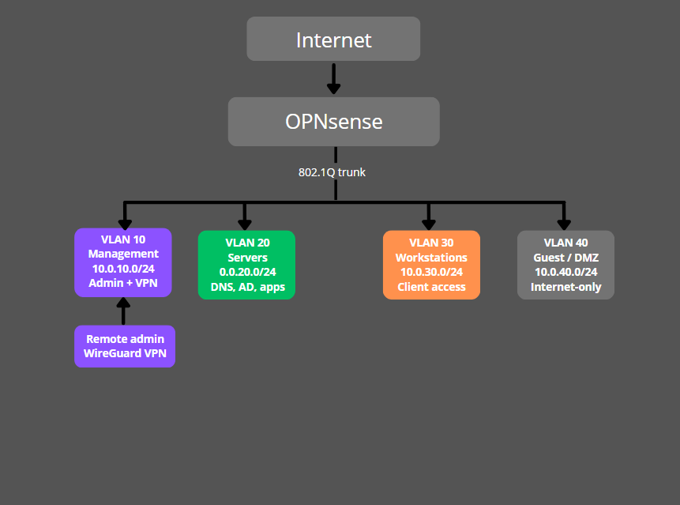

  
  <h1 align="center">Segmented Virtual Network Lab</h1>
  
OPNsense + VLAN + DHCP + DNS + VPN

  
  
## 📌 Project Description
### 🚧 Status: In progress
Building a segmented lab network with VLANs, DHCP/DNS, and WireGuard VPN using OPNsense.

📋 [See detailed build log](docs/progress.md)

 > [!CAUTION]
> **Simplification: no dedicated virtual switch.** The VirtualBox Host-only network (`vboxnet0`) acts as one shared L2 segment. OPNsense receives 802.1Q-tagged frames on `em1` (trunk), and each Debian host applies its own VLAN tag via a sub-interface (`enp0s8.<ID>`) to emulate an access port. VLAN isolation is therefore logical, not enforced by a switch; inter-VLAN traffic is controlled by OPNsense firewall rules.