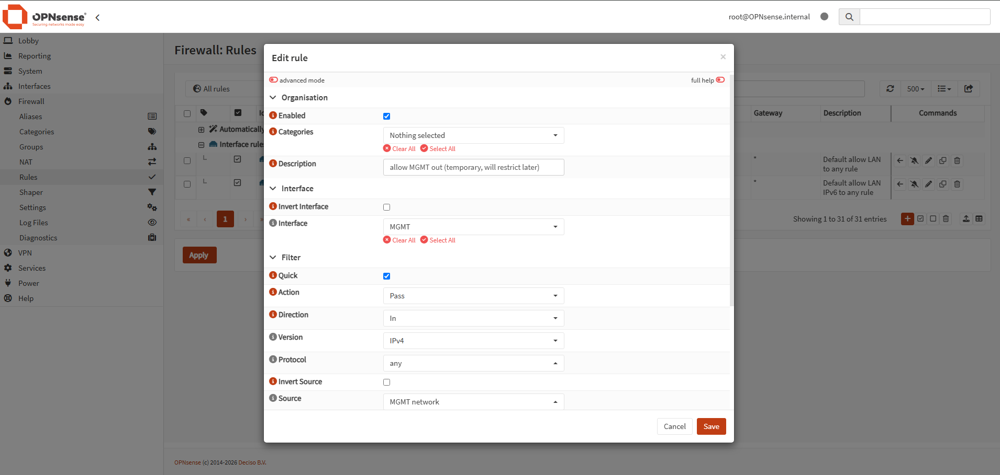
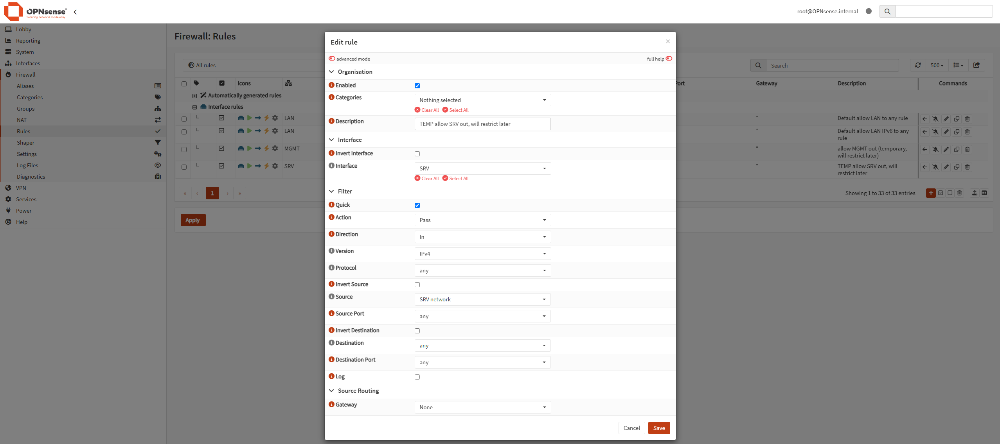

## OPNsense installation

- Installed OPNsense 26.7 (UFS) in VirtualBox.
- WAN: NAT adapter, DHCP from VirtualBox (10.0.2.x).
- LAN: Host-only adapter, static 192.168.56.10.
- Disabled "Block private networks" on WAN. It is required because VirtualBox NAT uses an RFC1918 range and OPNsense would otherwise block its own WAN traffic.

## VLAN 10 (Management): done

- Created the VLAN device on OPNsense: parent `em1` (LAN), tag 10, description MGMT.
- Assigned it as interface OPT1 with static IPv4 `10.0.10.1/24`.
- Added a firewall rule: Pass, source MGMT net, destination any (temporary, to be restricted later).
- Configured an 802.1Q sub-interface on the Debian host: `enp0s8.10`, static `10.0.10.2/24`.
- Verified: see [docs/tests/connectivity-tests.md](../docs/tests/connectivity-tests.md)

## VLAN 20 (Servers): domne

- Created the VLAN device on OPNsense: parent `em1` (LAN), tag 20, description SRV (`vlan02`).
- Assigned it as an interface with static IPv4 `10.0.20.1/24`.
- Added a firewall rule: Pass, source SRV net, destination any (temporary, to be restricted later).
- Created the server host as a Full Clone of the VLAN 10 test VM (new MAC addresses) and replaced `enp0s8.10` with an 802.1Q sub-interface `enp0s8.20`, static `10.0.20.2/24`, gateway `10.0.20.1`.
- Verified: see [tests/connectivity-tests.md](tests/connectivity-tests.md).

## Pitfalls

- **Sub-interface lost after reboot.** `ip link add` is not persistent. Fixed with `/etc/network/interfaces`, the `vlan` package and `8021q` in `/etc/modules`.
- **Parent interface down after reboot.** `enp0s8` must be declared too (`auto enp0s8`, `iface enp0s8 inet manual`).
- **"Network is unreachable" on ping to 8.8.8.8 and 192.168.56.10.** Not a firewall issue: the host had no default route. Fixed with `gateway 10.0.10.1`.
- **One host, one VLAN.** The clone must drop the old `enp0s8.10`, otherwise Linux routes between VLANs itself and bypasses the firewall.

## VLAN 30 (Workstations): in progress