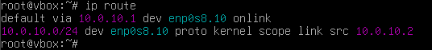
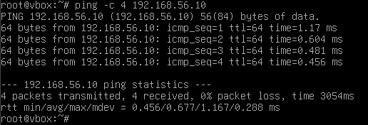
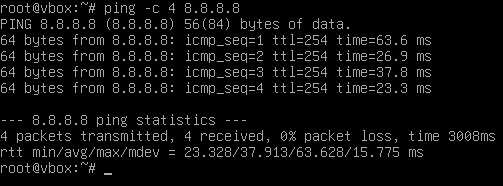
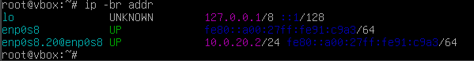
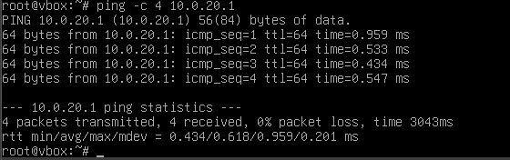
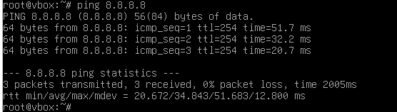
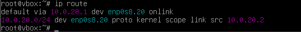
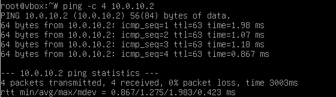

## VLAN 10 on the Debian test host

### Temporary setup (lost after reboot)

```bash
sudo apt install vlan -y
sudo modprobe 8021q
sudo ip link set enp0s8 up
sudo ip link add link enp0s8 name enp0s8.10 type vlan id 10
sudo ip addr add 10.0.10.2/24 dev enp0s8.10
sudo ip link set enp0s8.10 up
```

These commands live only in memory, so the configuration is reset after a reboot.

### Persistent setup

Load the 8021q module at boot:

```bash
echo 8021q | sudo tee -a /etc/modules
```

`/etc/network/interfaces`:

```
auto enp0s8
iface enp0s8 inet manual

auto enp0s8.10
iface enp0s8.10 inet static
    address 10.0.10.2/24
    gateway 10.0.10.1
    vlan-raw-device enp0s8
```

### Verification (before firewall hardening)

```bash
ip route
ping -c 4 192.168.56.10
ping -c 4 8.8.8.8
```




## VLAN 20 (Servers) on the Debian server host

The host is a Full Clone of the VLAN 10 test VM with new MAC addresses. The `vlan` package and the `8021q` module are inherited from the original, so only the interface configuration changes.

### Persistent setup

Replace the VLAN 10 block in `/etc/network/interfaces`:

```
auto enp0s8
iface enp0s8 inet manual

auto enp0s8.20
iface enp0s8.20 inet static
    address 10.0.20.2/24
    gateway 10.0.20.1
    vlan-raw-device enp0s8
```

Apply and remove the old sub-interface, so the host stays in a single VLAN:

```bash
sudo ifdown enp0s8.10
sudo ifup enp0s8.20
```

### Verification (before firewall hardening)

```bash
ip -br addr
ip route
ping -c 4 10.0.20.1
ping -c 4 192.168.56.10
ping -c 4 8.8.8.8
ping -c 4 10.0.10.2
```

The last ping is an inter-VLAN baseline (SRV to MGMT through OPNsense). It passes now because of the temporary rules and is expected to be blocked after default-deny.









